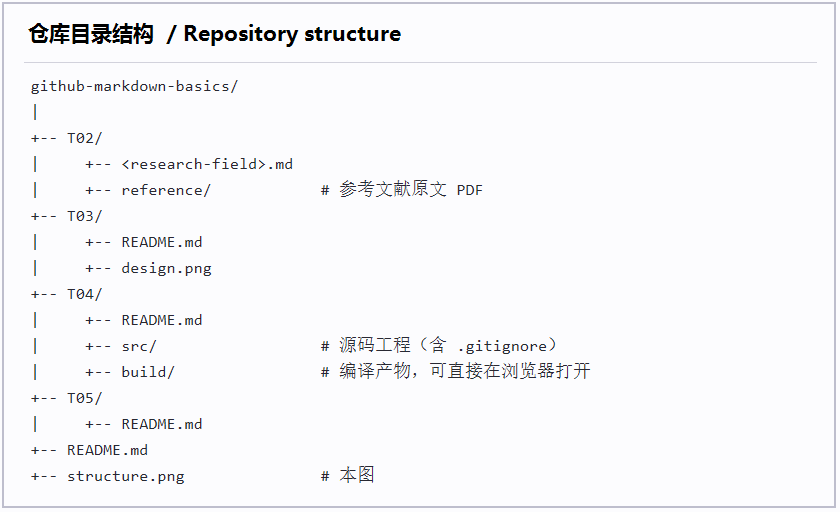

# GitHub 与 Markdown 基础作业

> 本仓库是「人机交互（可视分析）组」笔试的交付载体：T01–T05 各题在同一套目录结构里产出。

## 一、目录结构



```text
github-markdown-basics/
├── T02/
│   ├── Multimodal Video Visualization.md   # 1.2 研究总结（所选领域）
│   └── reference/                          # 12 篇参考文献原文 PDF
├── T03/
│   └── README.md                           # 1.3 设计方向：与 1.4 二选一，本人选了 1.4
├── T04/
│   ├── README.md                           # 1.4 实现思路与验证说明
│   ├── src/                                # 源码工程（含 .gitignore）
│   ├── build/                              # 编译产物，双击 index.html 即可浏览
│   ├── preview.png                         # 渲染结果预览
│   └── preview.provenance.json             # 预览图的来源锚点（产物 SHA-256）
└── T05/
    └── README.md                           # 1.5 AI 工具使用总结
```

## 二、各目录说明

- **T02** —— 研究总结（1.2）：所选领域为 **Multimodal Video Visualization**，正文 `T02/Multimodal Video Visualization.md`；12 篇原文 PDF 及其来源、版本说明在 `T02/reference/`。
- **T03** —— 设计方向（1.3）：见 [T03/README.md](T03/README.md)。1.3 与 1.4 二选一，本人选择前端方向，故本题未提交设计图。
- **T04** —— 可视化设计实现（1.4）：见 [T04/README.md](T04/README.md)。**零依赖**（只用 Node 内置模块，不需要 `npm install`），源码在 `T04/src/`，产物在 `T04/build/`，**双击即可在浏览器打开**（不需要本地服务器）。
- **T05** —— AI 工具使用总结（1.5）：见 [T05/README.md](T05/README.md)。

## 三、完成状态

| 目录 | 题目 | 状态 |
| --- | --- | --- |
| T02 | 1.2 研究总结（≥5 篇文献） | ✅ 已完成（7 篇主文 + 5 篇延伸对照） |
| T03 | 1.3 设计方向 | ⬜ 未做（与 1.4 二选一，理由见 T03/README.md） |
| T04 | 1.4 可视化设计实现（增强雷达图） | ✅ 已完成 |
| T05 | 1.5 AI 工具使用总结 | ✅ 已完成 |

图例：✅ 已完成 · ⬜ 未做

## 四、在本地使用

```bash
git clone git@github.com:Suozhang12138/github-markdown-basics.git
cd github-markdown-basics
```

查看 T04 的构建产物不需要任何环境——它不依赖本地服务器：

```text
直接双击 T04/build/index.html
```

想重新构建或复核 T04，在 `T04/` 目录下执行（零依赖，只要有 Node）：

```bash
node src/build.mjs                                 # 构建 + 数值/产物自检
node src/reverse-verify.mjs                        # 反向验证：防护拆掉后必须变红
node src/check-render.mjs --allow-no-browser       # 渲染自检（浏览器层可选）
```

## 五、Markdown 语法

本仓库用到的 Markdown 语法：

1. 标题：本文件的 `#` 与 `##`
2. 列表：本节的有序列表，以及第二节的无序列表
3. 代码块：上面的围栏代码块，均带语言标注（`text`、`bash`）
4. 图片：本文开头的仓库目录结构图
5. 链接：指向各子目录 README 的相对链接，以及 [本仓库在 GitHub 上的地址](https://github.com/Suozhang12138/github-markdown-basics)

---

作业题目：1.1 GitHub 与 Markdown 基础（必做）。
